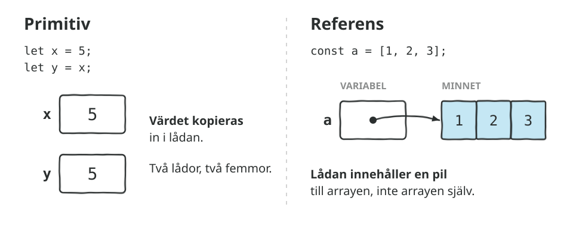
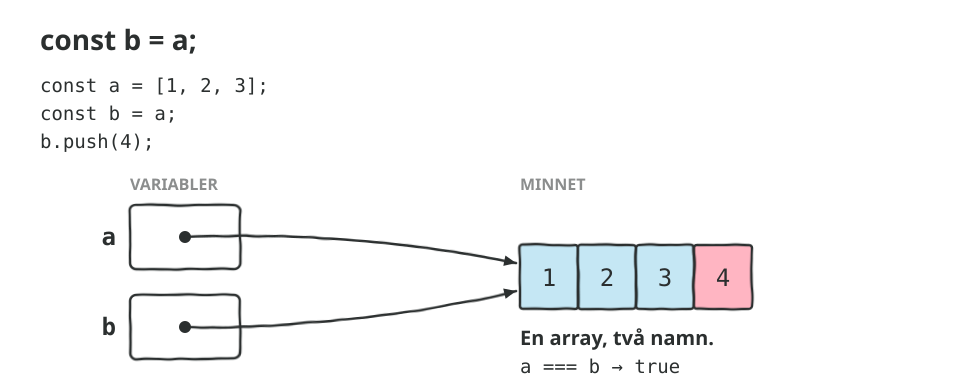
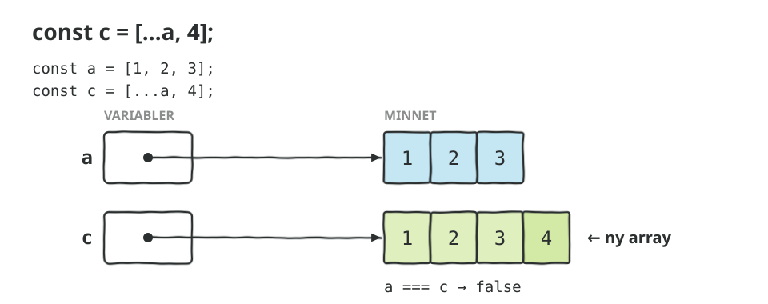
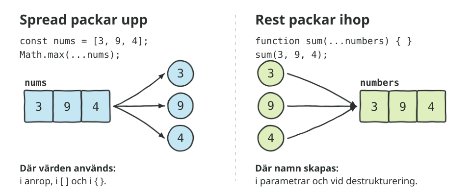
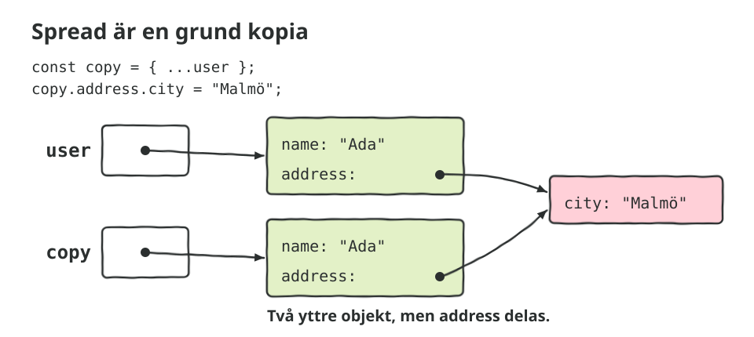
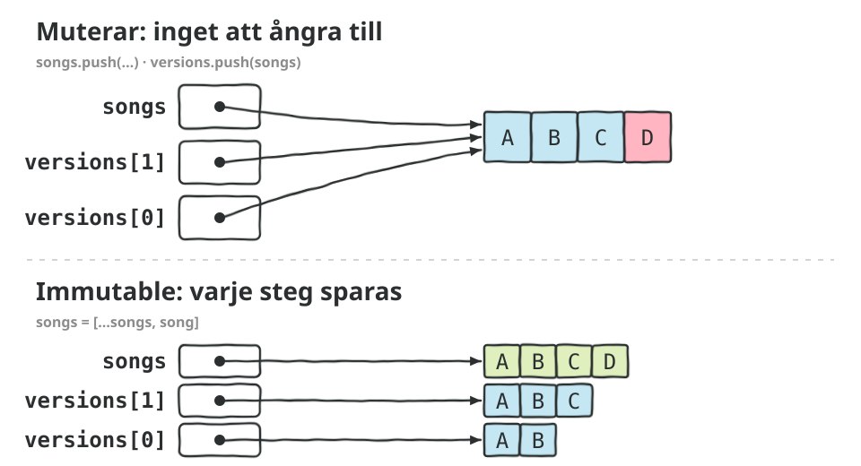
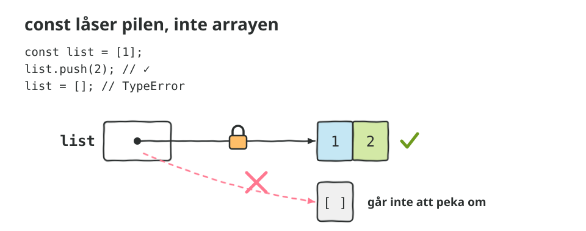
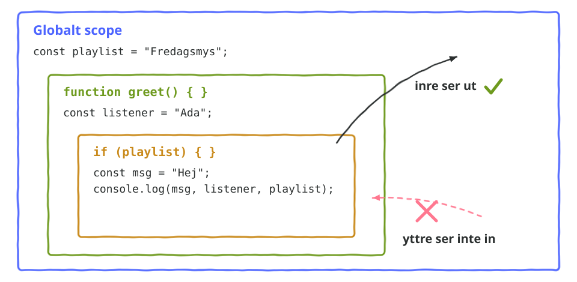

# Mutable, immutable och scope

Code-along i fyra delar. Spread och rest känner ni redan till. Här tittar vi på vad som händer under ytan: varför `b = a` inte kopierar en array, vad spread egentligen gör, och varför det spelar roll. Sist kopplar vi ihop det med scope.

## Kom igång

Öppna mappen i VS Code och starta Live Server. Ha DevTools (F12) öppet med **Console** synlig. Del 1 och 4 händer helt i konsolen, del 2 rättar sig själv på sidan och del 3 är en liten app.

**Gissa alltid innan ni kör.** Det är hela poängen med de här delarna.

## Lådor och pilar

Allt i den här code-alongen hänger på en enda bild. En primitiv (tal, sträng, boolean) ligger *i* variabeln. En array eller ett objekt gör det inte. Variabeln innehåller en **pil** till ett ställe i minnet.

## Del 1: Värden och referenser

`1-varden-och-referenser/`. Allt händer i `js/main.js` och i konsolen.

1. **Primitiver kopieras.** `y = x` ger en ny låda med samma värde.
2. **Arrayer och objekt delas.** `b = a` kopierar pilen, inte arrayen.
3. **Mutable och immutable.** Strängar går inte att ändra. Arrayer och objekt går.
4. **Spread på arrayer.** `[...numbers]` ger en ny array.
5. **Spread på objekt.** `{ ...ada, age: 37 }`. Sist vinner.
6. **Rest.** Samma `...` men tvärtom: packar ihop.
7. **Metoder.** `sort` muterar, `toSorted` gör det inte.
8. **Sidoeffekter.** Funktioner som ändrar det de får.
9. **Fällan.** Spread kopierar bara första nivån. `structuredClone` kopierar alla.
10. **Object.freeze.** Också bara första nivån.

## Muterar eller skapar nytt?

| Muterar originalet | Skapar nytt |
|---|---|
| `push`, `unshift` | `[...arr, x]`, `[x, ...arr]` |
| `pop`, `shift`, `splice` | `slice`, `filter`, `toSpliced` |
| `sort` | `toSorted` |
| `reverse` | `toReversed` |
| `arr[i] = x` | `arr.with(i, x)` |
| `obj.x = 1` | `{ ...obj, x: 1 }` |
| `delete obj.x` | `const { x, ...rest } = obj` |

`map` och `filter` har alltid skapat nytt. `toSorted`, `toReversed`, `toSpliced` och `with` kom 2023.

## Del 2: Skriv om utan att mutera

`2-ovningar/`. Alla funktioner i `js/ovningar.js` ger rätt svar redan, men de ändrar det de får. Skriv om dem så att originalet lämnas orört. Spara och ladda om: sidan visar ✅ eller ❌ för varje funktion, och vad som är fel.

Rör inte `js/test.js`, det är den som rättar.

Övning 5 och 6 är svårare. Där räcker det inte att kopiera det yttersta.

## Del 3: Spellistan med ångra-knapp

`3-spellista/`. En spellista där man kan lägga till, gilla, ta bort och sortera låtar. Allt fungerar utom **Ångra**. Stegen står i `js/app.js`.

1. **Lägg till en låt och klicka Ångra.** Läs felet i konsolen.
2. **Laga felet.** Ångra igen. Titta på historiken under listan: varför ser alla rader likadana ut?
3. **`addSong`** med spread.
4. **`removeSong`** med `filter`.
5. **`sortSongs`** med `toSorted`.
6. **`toggleLike`.** Prova först `songs = [...songs]` och ändra sedan låten. Gilla och ångra. Varför ändras hjärtat i historiken också?

**Extra:** Lägg till en **Gör om**-knapp som går framåt igen efter ett Ångra.

## Del 4: Scope

`4-scope/`. Allt händer i `js/main.js` och i konsolen.

1. **const låser pilen, inte arrayen.** `push` går, `list = []` går inte.
2. **Globalt scope.** Syns överallt.
3. **Funktionsscope.** Det som skapas i en funktion stannar där.
4. **Blockscope.** `let` och `const` lever mellan `{` och `}`.
5. **var läcker.** Därför använder vi det inte.
6. **Shadowing.** Samma namn i ett inre scope.
7. **Scope-kedjan.** Inre ser ut, yttre ser aldrig in.
8. **Extra: closure.** Funktioner minns var de skapades.
9. **Extra: `var` och `let` i en loop.**

Sist: **`js/vad-loggas.js`**. Sex korta funktioner. Skriv ner er gissning för varje, avkommentera sedan anropet och kör.

## Läs mer

- [MDN: Spread syntax](https://developer.mozilla.org/en-US/docs/Web/JavaScript/Reference/Operators/Spread_syntax)
- [MDN: Rest parameters](https://developer.mozilla.org/en-US/docs/Web/JavaScript/Reference/Functions/rest_parameters)
- [MDN: structuredClone()](https://developer.mozilla.org/en-US/docs/Web/API/Window/structuredClone)
- [MDN: Array.prototype.toSorted()](https://developer.mozilla.org/en-US/docs/Web/JavaScript/Reference/Global_Objects/Array/toSorted)
- [MDN: Scope](https://developer.mozilla.org/en-US/docs/Glossary/Scope)
